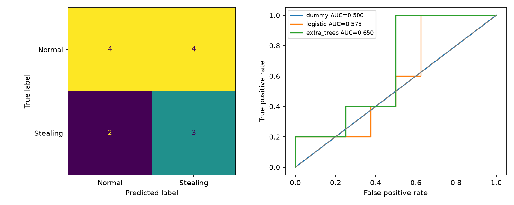

# Xây dựng hệ thống cảnh báo nghi vấn trộm xe máy ở hầm chung cư

Báo cáo đồ án môn học · Ngày thực hiện 27 tháng 10 năm 2026

**Thông tin nhóm:** xem và hoàn thiện `DANH_SACH_NHOM.csv`. Chưa có dữ liệu tên, MSSV, điểm cộng và đóng góp từ nhóm nên các trường này để trống theo mẫu, không tự tạo thông tin.

## Tóm tắt và phạm vi thực hiện

Đề tài hướng đến hỗ trợ bảo vệ phát hiện sớm tình huống đáng ngờ tại bãi xe. Sản phẩm đã xây dựng gồm pipeline xử lý video, mô hình học máy được huấn luyện trên video thật, giao diện web cục bộ, sổ cảnh báo có xác minh, mã nguồn tái lập và kết quả kiểm thử. Bản thực nghiệm dùng các video Stealing và Normal của UCF-Crime. Đây là dữ liệu trộm tài sản nói chung; nhãn Stealing không đồng nghĩa với trộm xe máy, càng không đồng nghĩa với trộm tại hầm chung cư. Kết quả thực nghiệm vì vậy đánh giá bài toán nền, chưa chứng minh khả năng triển khai thật tại hầm.

Mô hình sử dụng đặc trưng thị giác truyền thống và thống kê theo thời gian, phù hợp máy CPU và yêu cầu giải thích từng nhóm đặc trưng của môn học. Đầu ra phục vụ người xem xét. Khi thông tin không đủ, hệ thống cần báo thiếu chất lượng thay vì suy diễn một người là kẻ trộm. Các phần nhận diện từng xe, đối chiếu thẻ xe và luồng camera liên tục được trình bày là thiết kế mở rộng, chưa phải tính năng đã chạy.

## 1 Thu thập dữ liệu

### 1.1 Nguồn dữ liệu tìm được

UCF-Crime do Sultani, Chen và Shah giới thiệu tại CVPR 2018 gồm 1.900 video giám sát dài, với 13 nhóm bất thường và hoạt động bình thường. Nhãn train ở cấp video là động cơ của hướng học giám sát yếu trong nghiên cứu gốc [1, 2]. Đồ án này không tái hiện mô hình MIL của bài báo. Nhóm dùng một bộ phân lớp video đơn giản trên đặc trưng tự trích xuất.

Bản sao `mteb/ucf-crime` trên Hugging Face có video MP4 riêng lẻ và metadata parquet [3]. Script tải dùng revision `8d783bb` để cố định nguồn. Metadata bản sao chứa trường category, video_path và khoảng bất thường ở tập test. Đồ án lấy đúng nhãn category; không đoán nhãn bằng nội dung tên file. Nhãn thời gian test được giữ trong manifest nhưng không dùng tối ưu mô hình hoặc ngưỡng.

Lựa chọn dữ liệu được chốt trước huấn luyện: chỉ lấy hai lớp Normal và Stealing; chọn ngẫu nhiên với seed 42 trong từng lớp và split gốc; ưu tiên file không quá 30 MB để giới hạn chi phí tải. Riêng các video Stealing ở test được giữ dù lớn hơn 30 MB để không làm mất thêm lớp dương vốn ít. Từ train gốc lấy tối đa 20 video train và 5 video validation mỗi lớp; từ test gốc lấy tối đa 8 video mỗi lớp. Số lượng thực tế được ghi ở mục 7. Đây là tập con phục vụ đồ án, không phải kết quả benchmark toàn UCF-Crime. Bộ lọc kích thước có thể thiên lệch về thời lượng, độ phân giải hoặc mức nén.

Mỗi file có URL nguồn, kích thước và SHA-256. Script kiểm tra video_id và hash không trùng giữa các split. Điều này ngăn trùng file chính xác, nhưng không phát hiện mọi bản re-encode hay cùng camera ở các file khác nhau. Chưa kiểm chứng tách biệt camera trên UCF vì metadata hiện dùng không có định danh camera. Bản nén nộp bài giữ manifest, metadata và đặc trưng nhỏ gọn; không chứa video thật của nguồn.

### 1.2 Dữ liệu đúng miền cần bổ sung

Để chuyển từ mô hình nền sang đúng đề tài hầm chung cư, cần quay có sự đồng ý của người tham gia và đơn vị quản lý, dùng xe và đạo cụ thuộc quyền sử dụng của nhóm. Dàn dựng tình huống, không thực hiện phá khóa hoặc lấy tài sản của người không tham gia. Một kế hoạch khởi điểm đề xuất là 150–300 lượt tình huống nhiều diễn viên và nhiều buổi, kết hợp khoảng 10–20 giờ hoạt động bình thường. Đây là kế hoạch, chưa phải dữ liệu đã thu thập. Số lượng cuối cùng phải tăng theo đường cong học và sai số đánh giá.

Các tình huống dương: tiếp cận xe rồi thao tác kéo dài ở vị trí khóa, kiểm tra nhiều xe liên tiếp, dắt xe sau chuỗi tương tác bất thường. Các tình huống âm khó: chủ xe tìm chìa, khóa kẹt, đội mũ, lấy đồ cốp, nhân viên di chuyển xe, đứng chờ người thân, đi ngang và sửa xe có phép. Cần cả đoạn không có người, đông người, xe che nhau, ánh sáng bật tắt và ánh đèn pha. Đặc biệt phải có chủ xe và người dàn dựng thực hiện động tác giống nhau; nếu không, mô hình dễ học trang phục hoặc diễn viên thay vì hành vi.

Lưu video gốc và metadata gồm camera_id, session_id, thời điểm, FPS, độ phân giải, vị trí xe và điều kiện sáng. Gán nhãn lớp và mốc bắt đầu/kết thúc sự kiện; với pipeline phát hiện đối tượng cần thêm bounding box người, xe và track_id. Một schema đề xuất: `video_id, camera_id, session_id, actor_id, start_sec, end_sec, event_type, vehicle_id, authorization, annotator, confidence`. Người gán nhãn đánh dấu điều nhìn thấy, phân biệt “thao tác tại xe”, “dắt xe” với kết luận “không được phép” cần đối chiếu ngoài video.

Hai người gán nhãn độc lập một phần dữ liệu, thống nhất tiêu chí và xử lý bất đồng. Chia theo buổi quay, camera và người tham gia trước khi cắt clip; mọi clip cùng nguồn chỉ nằm ở một split. Tập test nên chứa camera hoặc thời điểm mới, không chỉ góc quay đã thấy khi train. Script `import_local.py` hỗ trợ kiểm tra camera và session không giao nhau khi nhập dữ liệu nhóm.

## 2 Phát biểu bài toán và input output

### 2.1 Bài toán mục tiêu

Với luồng CCTV tại khu để xe, hệ thống tìm đoạn tương tác người–xe có dấu hiệu đáng ngờ, tạo cảnh báo kèm bằng chứng để bảo vệ xác minh. Không thể luôn phân biệt chủ xe và người không được phép chỉ bằng dáng đi hoặc thao tác tay. Trường hợp động tác giống nhau cần thông tin thẻ xe, giao dịch cổng, đăng ký xe hoặc xác minh của bảo vệ.

Input mục tiêu gồm luồng video và timestamp, mã camera, vùng bãi đỗ, tùy chọn bản đồ vị trí xe và tín hiệu cấp quyền. Output mục tiêu gồm event_id, khoảng thời gian, vùng người/xe, điểm nghi vấn, tình trạng chất lượng, liên kết bằng chứng và trạng thái xử lý. Nhãn vận hành có thể gồm bình thường, nghi vấn và không đủ thông tin. Ngưỡng cảnh báo được điều chỉnh theo tỷ lệ bỏ sót, báo giả và năng lực xem xét của bảo vệ.

### 2.2 Bài toán đã thực nghiệm

Input là một file video CFR giải mã được bằng OpenCV. Mỗi video được biểu diễn bằng tối đa 12 cửa sổ dài 4 giây; mỗi cửa sổ lấy mẫu 4 FPS. Vector đặc trưng video có 984 chiều. Output gồm điểm Stealing/Normal, quyết định `review`, `low_score` hoặc `insufficient_quality`, thống kê chất lượng và thời gian xử lý.

Huấn luyện dùng nhãn cả video y thuộc {0,1}: 0 là Normal, 1 là Stealing. Không gán nhãn dương cho mọi frame trong một video Stealing. Mô hình học ánh xạ từ vector video sang điểm lớp 1. `predict_proba` cung cấp điểm từ bộ phân lớp, nhưng chưa hiệu chuẩn thành xác suất rủi ro trong môi trường thật. Ngưỡng được chọn trên validation theo F1; chưa có cơ sở gọi ngưỡng đó tối ưu cho bãi xe.

Chế độ dense tạo đường điểm bằng ngữ cảnh trượt gồm tối đa 12 cửa sổ gần nhất, tương đương tối đa 48 giây. Mô hình vẫn chỉ được đánh giá ở cấp video; lấy mẫu liên tục khác với lấy mẫu trải đều lúc train. Đường điểm và việc gộp các cửa sổ liên tiếp chỉ là công cụ thử nghiệm để người xem tìm đoạn cần kiểm tra, chưa phải bộ định vị hành vi đã được xác nhận.

## 3 Mô tả hệ thống ứng dụng

### 3.1 Thiết kế vận hành đầy đủ

Luồng đề xuất: camera RTSP → bộ đệm và kiểm tra tín hiệu → tiền xử lý → phát hiện người và xe → theo dõi qua thời gian → trích xuất tương tác → bộ nhận dạng → máy trạng thái cảnh báo → lưu bằng chứng → giao diện bảo vệ → xác minh. Máy chủ tại tòa nhà xử lý video; dịch vụ web cung cấp quản lý và tra cứu. Dịch vụ thông báo chỉ gửi sau chính sách vận hành đã thống nhất. Bản demo chưa kết nối RTSP hoặc gửi thông báo ra bên ngoài.

| Người dùng | Nhiệm vụ trong hệ thống mục tiêu |
|---|---|
| Quản trị | Cấu hình camera và ROI, quản lý tài khoản, xem lỗi thiết bị, quản lý thời gian lưu và nhật ký |
| Bảo vệ | Xem cảnh báo, mở đoạn trước/sau sự kiện, kiểm tra tại hiện trường, xác nhận báo giả hoặc sự kiện cần xử lý |
| Cư dân | Đăng ký xe qua quy trình xác minh, nhận thông báo liên quan xe của mình, phản hồi tình trạng; không xem toàn bộ camera |
| Người bảo trì mô hình | Đánh giá sai số, quản lý phiên bản và ngưỡng qua dữ liệu validation, theo dõi thay đổi miền dữ liệu |

Ví dụ luồng xử lý mục tiêu: bộ nhận dạng phát hiện chuỗi tương tác đáng ngờ; máy trạng thái yêu cầu bằng chứng liên tục trước khi mở một sự kiện; lưu đoạn trước/sau và mã camera; bảo vệ kiểm tra thẻ hoặc trực tiếp xác minh; kết luận `confirmed` hoặc `false_alarm` cùng ghi chú. Các cảnh báo gần nhau của cùng track được gộp và có cooldown, tránh gây quá tải. Không tự động coi một cảnh báo là bằng chứng để quy kết người.

Khi mất kết nối, camera bị che hoặc hình quá tối, hệ thống phát lỗi thiết bị/thiếu chất lượng thay vì đưa ra kết luận an toàn. Cần đo độ trễ đầu cuối, giám sát hàng đợi và dung lượng lưu. Nếu lưu liên tục N camera ở bitrate b Mbps, một ngày xấp xỉ N × b × 10,8 GB theo đơn vị thập phân, chưa tính overhead. Thời gian giữ dữ liệu do đơn vị vận hành quy định; tách bằng chứng sự kiện với lưu video liên tục.

### 3.2 Các chức năng đã chạy trong demo

Ứng dụng Streamlit chạy cục bộ có tải video/chọn video, suy luận bằng mô hình đã train, xem điểm và chất lượng, xuất JSON, lưu cảnh báo chờ xác minh, cập nhật kết luận và nhật ký SQLite. Khi người dùng bấm lưu cảnh báo, ứng dụng lưu JSON và khung hình đầu video; ảnh này chỉ minh họa nguồn, không được gọi là ảnh thời điểm trộm. Phân tích mặc định chỉ lấy mẫu; chế độ dense duyệt toàn bộ cửa sổ và chậm hơn.

Sidebar có vai trò mô phỏng Bảo vệ, Quản trị và Cư dân để minh họa trải nghiệm. Đây không phải cơ chế đăng nhập hay phân quyền an toàn. Giao diện Cư dân chỉ mô tả chức năng tương lai. Chưa triển khai quản lý tài khoản, RTSP, YOLO, tracking, nhận diện biển số, đối chiếu thẻ, ứng dụng di động hoặc thông báo đẩy. Vì vậy demo phù hợp trình diễn môn học trên máy cá nhân.

## 4 Các bước tiền xử lý

### 4.1 Video dài ngắn khác nhau

Giữ video gốc và timestamp. Chia theo đơn vị thời gian thay vì ép mọi video thành cùng số frame bằng thay đổi tốc độ. Trong demo, mỗi cửa sổ dài tối đa 4 giây; lấy 4 frame mỗi giây. Video ngắn hơn 4 giây dùng các frame thật đọc được và lưu valid_frames, không tạo nội dung còn thiếu. Video dài lấy tối đa 12 cửa sổ trải đều để giới hạn chi phí. Cách này có thể bỏ lỡ một sự kiện ngắn giữa các cửa sổ; chế độ dense giảm khoảng trống lấy mẫu nhưng không giải quyết được thiếu dữ liệu nhận dạng.

Nếu dùng CNN 3D với tensor cố định T frame, có thể pad và thêm mask cho phần thiếu, hoặc loại clip quá ngắn theo quy tắc đã chốt. Không chia ngẫu nhiên các clip lân cận sang train và test. Với nguồn VFR, cần lấy mẫu bằng timestamp decoder hoặc chuyển CFR trước; demo hiện dựa chỉ số frame và yêu cầu CFR, không tự nhận hỗ trợ VFR chính xác.

### 4.2 Kích thước khung hình khác nhau

Demo giữ tỷ lệ, resize nội dung vào 128 × 96 và letterbox phần còn lại. Histogram màu và texture dùng mask để loại padding; histogram gradient không tính trọng số ở phần padding. Resize xuống dùng INTER_AREA, phóng lên dùng INTER_LINEAR. Độ phân giải này là lựa chọn tiết kiệm CPU, có thể làm mất động tác nhỏ tại ổ khóa và không phù hợp nhận biển số.

Trong bản nâng cấp cần giữ nguồn 720p/1080p hoặc phù hợp khoảng cách camera, phát hiện đối tượng rồi crop ROI người–xe ở độ phân giải đủ lớn. ROI theo tỷ lệ giúp áp dụng cấu hình lên nhiều độ phân giải; phép đổi tọa độ phải được lưu để hiển thị đúng vị trí trên video nguồn. Phóng to ảnh không khôi phục chi tiết đã mất.

### 4.3 Ánh sáng khác nhau

Đo độ sáng, tỷ lệ pixel quá tối/quá sáng trên vùng nội dung trước khi cân bằng. Giảm nhiễu nhẹ rồi áp dụng CLAHE với clipLimit 2, lưới 8 × 8 trên ảnh xám để cải thiện tương phản cục bộ [4]. Đặc trưng HSV lấy từ ảnh màu đã resize để giữ thông tin màu gốc. CLAHE không làm hai điều kiện chiếu sáng trở nên tương đương hoàn toàn và có thể tăng nhiễu.

Gamma, white balance hoặc mô hình tăng sáng chỉ nên thêm sau khi thử nghiệm trên validation. Giữ video gốc để kiểm tra; tránh dùng ảnh tăng cường tạo chi tiết giả làm bằng chứng. Nếu vùng thao tác bị cháy sáng hoặc tối đen thì gắn cờ thiếu thông tin, điều chỉnh vị trí camera hoặc bổ sung chiếu sáng. Quay dữ liệu ngày/đêm và thay đổi đèn để đánh giá khả năng tổng quát hóa.

### 4.4 Nhiễu mờ giật lag và chất lượng thấp

Gaussian 3 × 3 với sigma 0,5 làm giảm nhiễu mức nhẹ trong demo. Nhiễu nặng có thể thử median/bilateral hoặc denoising theo thời gian, nhưng lọc mạnh dễ làm mất tay và dụng cụ nhỏ. Độ mờ được ước lượng bằng phương sai Laplacian; ngưỡng hiện tại chỉ là heuristic trên ảnh sau resize, chưa hiệu chuẩn cho từng camera. Video thiếu texture cũng có thể có giá trị Laplacian thấp dù không bị mất nét.

Demo đánh dấu thiếu chất lượng khi số frame đọc được dưới 4 trong cửa sổ, độ sáng trung bình dưới 12, phương sai Laplacian dưới 8, hoặc FPS nguồn dưới 4. Nếu dưới một nửa số cửa sổ đạt kiểm tra này, quyết định là insufficient_quality. Đây không phải bộ đo chất lượng toàn diện. Chưa phát hiện tin cậy frame đóng băng, lag mạng, mọi kiểu blur hoặc mất gói. Lỗi giải mã frame được bỏ qua và số frame hợp lệ vẫn được báo cáo.

Với camera mạng thực tế cần đo chênh timestamp, frame trùng, độ trễ và tỷ lệ mất frame; không coi frame lặp là quan sát độc lập. Không nội suy chuyển động qua khoảng mất hình lớn để khẳng định hành vi. Với rung nhẹ, demo trừ vector optical flow trung vị để giảm chuyển động nền chung; thao tác này không thay thế ổn định video bằng phép biến đổi hình học. Camera rung mạnh hoặc đổi góc phải được phát hiện và cấu hình lại.

### 4.5 Quy trình chuẩn hóa tổng thể

1. Kiểm tra quyền sử dụng và metadata, hash file, khả năng giải mã; lưu bản gốc.
2. Chia dữ liệu theo video nguồn/camera/buổi quay trước khi cắt clip.
3. Đồng bộ thời gian, xử lý VFR hoặc timestamp không ổn định; xác định vùng quan tâm.
4. Cắt cửa sổ theo giây, lấy mẫu FPS mục tiêu và ghi nhận frame thiếu.
5. Resize giữ tỷ lệ, letterbox và mask; crop đối tượng nếu có detector.
6. Đo chất lượng trên ảnh gốc đã resize, lọc nhiễu nhẹ, cân bằng sáng có kiểm soát.
7. Trích xuất đặc trưng và chuẩn hóa số học bằng tham số học từ train.
8. Đánh giá chất lượng; lưu cùng kết quả để người vận hành biết khi nào không đủ thông tin.

Demo thực hiện các bước phù hợp file video CFR và đặc trưng toàn khung. Các bước mạng thời gian thực, ROI đối tượng và ổn định hình học thuộc thiết kế mở rộng. Không có một phép tiền xử lý bảo đảm tạo video “chuẩn” từ mọi đầu vào; tiêu chí đúng là giữ thông tin liên quan, kiểm soát sai lệch và biết từ chối khi tín hiệu không đủ.

## 5 Trích xuất đặc trưng

### 5.1 Hình dạng

Demo tính gradient bằng Sobel, góc vô hướng 0–180 độ chia 9 bin, tổng hợp trên lưới 4 × 3 ô, mỗi ô 32 × 32 pixel và chuẩn hóa L2. Vector có 108 chiều mỗi frame. Đây là histogram gradient theo ô kiểu HOG đơn giản; không tuyên bố đúng toàn bộ HOG Dalal–Triggs với các block chồng lấn. Đặc trưng phản ánh cạnh và dáng tổng thể, không tự nhận biết động tác phá khóa.

### 5.2 Màu sắc

Histogram HSV có H 12 bin, S 8 bin và V 8 bin, tổng 28 chiều, chỉ tính vùng nội dung. Chuẩn hóa tổng histogram làm giảm ảnh hưởng kích thước. Màu hỗ trợ mô tả cảnh/người nhưng dễ học lối tắt nền, áo hoặc camera. Đổi ánh sáng và camera có thể làm đặc trưng này kém ổn định; không dùng màu để xác định ai có quyền lấy xe.

### 5.3 Đặc trưng cục bộ

LBP so sánh 8 láng giềng với pixel giữa, tạo mã 8 bit, gộp mã vào 16 bin bằng phép chia nguyên cho 16. Đây là LBP rút gọn, không phải uniform LBP chuẩn. Kết hợp gradient từng ô, nhóm này mô tả kết cấu và hình dạng cục bộ. Có thể thử ORB/SIFT hoặc keypoint bàn tay/tư thế ở bản nâng cấp khi độ phân giải cho phép, nhưng demo không dùng chúng.

### 5.4 Đặc trưng toàn cục

Một frame có 152 chiều gồm 108 gradient, 28 HSV và 16 LBP. Với cửa sổ 4 giây, lấy mean và std theo frame, được 304 chiều appearance. Các thống kê gộp có kích thước cố định khi số frame thay đổi, nhưng mất nhiều thông tin thứ tự hành động. Sau đó gộp theo các cửa sổ bằng mean, std và percentile 90 để có vector video cố định. Vì gộp toàn cảnh, mô hình có thể phân biệt bối cảnh thay vì tương tác người–xe; đó là giới hạn cần kiểm tra bằng test camera mới.

### 5.5 Đặc trưng hành động

Demo dùng dense optical flow Farnebäck giữa hai frame xám liên tiếp [5]. Trừ vector flow trung vị để giảm thành phần tịnh tiến chung; tính trung bình và percentile 90 độ lớn, tỷ lệ pixel có flow lớn hơn 1, mức sai khác ảnh trung bình và histogram hướng chuyển động 8 bin. Có 12 số mỗi cặp frame; lấy mean/std qua thời gian được 24 chiều.

Vector cửa sổ: 304 appearance + 24 motion = 328 chiều. Vector video: mean + std + p90 của 328 chiều = **984 chiều**. Các chỉ số sáng/mờ được báo riêng để kiểm tra chất lượng, không nối vào vector phân lớp. Flow thể hiện thay đổi hình ảnh chứ không có ngữ nghĩa “ăn trộm”. Tần số 4 FPS có thể bỏ lỡ động tác tay nhanh. Cần đặc trưng tương tác người–xe, tư thế và chuỗi thời gian ở giai đoạn nâng cấp.

## 6 Mô hình nhận dạng và lý do lựa chọn

### 6.1 Các lựa chọn đã huấn luyện

| Giải pháp | Vai trò và lý do |
|---|---|
| DummyClassifier theo prior train | Mốc so sánh, giúp biết mô hình có hơn dự đoán theo phân bố lớp hay không |
| StandardScaler và Logistic Regression | Ít tham số hơn, dễ tái lập, phù hợp tập train nhỏ; quan hệ tuyến tính có thể thiếu khả năng biểu diễn |
| ExtraTreesClassifier | Học quan hệ phi tuyến giữa các nhóm đặc trưng, chạy CPU; cần giới hạn độ sâu để giảm overfit [6] |

Logistic Regression dùng C = 0,1, class_weight balanced, max_iter 3000; StandardScaler chỉ fit trên train trong Pipeline. ExtraTrees dùng 300 cây, max_depth 6, min_samples_leaf 2, class_weight balanced, seed 42. Mỗi video tạo một mẫu huấn luyện; các frame trong video không bị coi là mẫu test độc lập. Không train deep learning từ đầu trên vài chục video vì khó tổng quát hóa và không cần thiết để chứng minh pipeline cho môn học.

Với mỗi mô hình, thử ngưỡng 0,10 đến 0,90, bước 0,01 trên validation và tối đa hóa F1. Nếu hòa, chọn gần 0,5 hơn. Chọn giữa Logistic và ExtraTrees theo F1 validation, rồi ROC-AUC validation; nếu vẫn hòa ưu tiên Logistic. Dummy chỉ là đối chứng. Không refit trên validation trong bản hiện tại; mô hình lưu chính là mô hình chỉ học từ train. Test được dùng báo cáo sau khi mô hình và ngưỡng đã chốt. So sánh test của các mô hình là mô tả, không dùng để đổi mô hình đã chọn.

### 6.2 Giải pháp cho phiên bản đúng miền

Khi có dữ liệu hầm, đề xuất phát hiện người/xe bằng detector đã pretrain, tracking để giữ định danh tạm thời, crop vùng tương tác và dùng encoder video pretrain kết hợp head nhỏ hoặc mô hình chuỗi. Khi nhãn chỉ ở cấp video có thể nghiên cứu MIL như hướng của bài gốc [2]; khi có mốc sự kiện thì học temporal action localization phù hợp hơn. Không thể khẳng định CNN–LSTM, Transformer hoặc một bản YOLO chắc chắn tốt nhất trước khi thử trên cùng split.

Một mô hình phát hiện đối tượng chỉ biết “có người, có xe” không đủ để nhận biết trộm. Ngồi lâu hoặc dắt xe cũng xảy ra hợp lệ. Tín hiệu hành vi cần kết hợp thời gian, quan hệ người–xe và quyền di chuyển xe; cảnh báo vẫn cần xác minh. Quy tắc loitering đơn lẻ có thể làm baseline, nhưng phải đo báo giả với chủ xe và nhân viên.

### 6.3 Cách đánh giá

Thực nghiệm hiện tại báo cáo precision, recall, F1, ROC-AUC, average precision và confusion matrix ở cấp video. Precision = TP/(TP+FP), recall = TP/(TP+FN); F1 là trung bình điều hòa của hai đại lượng. ROC-AUC và AP đánh giá thứ tự điểm, còn precision/recall phụ thuộc ngưỡng. Khi dương tính rất ít, cần đọc cả số TP, FP, FN và không chỉ nhìn accuracy.

Trong môi trường hầm cần thêm event recall, báo giả/camera/giờ, thời gian từ đầu sự kiện đến cảnh báo, độ trễ đầu cuối và hiệu năng trong tối/che khuất. Ghép sự kiện dự đoán–nhãn bằng quy tắc thời gian hoặc tIoU chốt trước, chỉ đếm mỗi sự kiện một lần. Bootstrap phải lấy mẫu video hoặc buổi quay, không coi các frame kề nhau là độc lập. Bản này chưa tính event recall, temporal IoU hay khoảng tin cậy; không được suy ra các số đó từ accuracy video.

## 7 Kết quả chạy và hướng dẫn tái lập

<!-- RESULTS_BEGIN -->
| Tập | Normal | Stealing | Tổng |
|---|---:|---:|---:|
| train | 20 | 20 | 40 |
| val | 5 | 5 | 10 |
| test | 8 | 5 | 13 |

Tổng 63 video thật, dung lượng nguồn 908.7 MB (đơn vị thập phân).

Mô hình chọn bằng validation: **extra_trees**. Ngưỡng **0.50**. Vector đầu vào 984 chiều.

| Mô hình | F1 validation | Ngưỡng validation | Precision test | Recall test | F1 test | ROC AUC test | AP test |
|---|---:|---:|---:|---:|---:|---:|---:|
| dummy | 0.667 | 0.50 | 0.385 | 1.000 | 0.556 | 0.500 | 0.385 |
| logistic | 0.667 | 0.50 | 0.429 | 0.600 | 0.500 | 0.575 | 0.555 |
| extra_trees | 0.769 | 0.50 | 0.429 | 0.600 | 0.500 | 0.650 | 0.597 |

Confusion matrix của mô hình chọn: TN = 4, FP = 4, FN = 2, TP = 3. Hàng là nhãn thật Normal/Stealing; cột là dự đoán Normal/Stealing.

Accuracy test = 0.538. Lần chạy huấn luyện ghi nhận 25.0 giây, có sử dụng cache đặc trưng từ các video đã xử lý; đây không phải benchmark trích xuất toàn bộ dữ liệu từ đầu.

**Nhận xét:** Đây là số đo thật trên tập con nhỏ, không phải độ chính xác của hệ thống trong hầm. F1 test của mô hình chọn còn thấp hơn Dummy dự đoán tất cả là dương; AUC cao hơn 0,5 chỉ cho thấy khả năng xếp hạng có tín hiệu trong tập nhỏ này, chưa đủ khẳng định hiệu quả cảnh báo. Mỗi video dương bị bỏ sót làm recall thay đổi đáng kể. Cảnh và góc camera có thể là lối tắt mà mô hình đã học. Chưa chứng minh mô hình tốt hơn trong mọi điều kiện ánh sáng hoặc nhận đúng thao tác tại khóa xe. Không so sánh trực tiếp với AUC frame-level trong bài UCF-Crime gốc.



**Kiểm chứng thực thi:** 5 kiểm thử pytest đều đạt; Streamlit AppTest mở ứng dụng, suy luận video minh họa và chuyển giao diện cư dân không có exception; CLI đã suy luận một video test thật và một video tổng hợp. Kiểm thử xác nhận chương trình hoạt động, không chứng minh độ chính xác ngoài tập test.

**Ví dụ video thật thuộc test:** `Stealing019_x264.mp4`, điểm 0.456, quyết định `low_score`, 41 cửa sổ, thời gian 5.03 giây.

**Ví dụ video hình vẽ kiểm tra pipeline:** `loitering_then_move.mp4`, điểm 0.658, quyết định `review`, 5 cửa sổ, thời gian 1.91 giây.
Đây không phải kết quả nhận dạng đúng/sai trên dữ liệu thật.

<!-- RESULTS_END -->

### 7.1 Cấu trúc source code

`src/features.py` dùng chung tiền xử lý và trích xuất cho train/inference. `scripts/download_data.py` lấy dữ liệu có provenance. `scripts/train.py` trích xuất/cache, train, chọn mô hình và lưu metrics. `src/predict.py` suy luận và `src/events.py` minh họa gộp cửa sổ nghi vấn liên tiếp. `src/storage.py` quản lý SQLite và audit. `app.py` cung cấp giao diện Streamlit. `scripts/import_local.py` nhập dữ liệu hầm theo schema có split/camera/session. `tests/test_pipeline.py` kiểm tra các điều kiện có thể làm sai kết quả.

### 7.2 Lệnh chạy

```bash
python3 -m venv .venv
source .venv/bin/activate
python -m pip install -r requirements.txt
python scripts/make_demo.py
python -m streamlit run app.py
```

Để tái lập từ video thật:

```bash
python scripts/download_data.py
python scripts/train.py
python scripts/predict.py data/videos/Stealing019_x264.mp4 --dense
python -m pytest -q
```

Trong bản nén có cache đặc trưng để huấn luyện lại không cần tải toàn bộ video. Hai video hình vẽ trong data/demo do code tạo ra chỉ kiểm tra giao diện và luồng xử lý; không nằm trong train/val/test, không dùng để tính accuracy. Đọc README để xử lý Windows, VFR hoặc nhập dữ liệu riêng. Môi trường chạy thực tế được ghi trong `requirements-lock.txt` và `artifacts/environment.json`.

### 7.3 Điều kiện trước khi nộp

Điền thông tin nhóm và tỷ lệ đóng góp thực tế; kiểm tra tổng đóng góp bằng 100%. Mở báo cáo HTML trong trình duyệt, có thể in thành PDF nếu giảng viên yêu cầu định dạng đó. Chạy lại ứng dụng và thử video nhóm dự định trình diễn. Trình bày rõ tập dữ liệu đã dùng và phần dữ liệu hầm chưa thu thập. Không đổi tên thí nghiệm Stealing/Normal thành kết quả nhận dạng trộm xe máy tại hầm.

## Tài liệu tham khảo

[1] CRCV, trang dự án UCF-Crime, mô tả dữ liệu và phân chia: https://www.crcv.ucf.edu/research/real-world-anomaly-detection-in-surveillance-videos/

[2] Waqas Sultani, Chen Chen, Mubarak Shah. Real-world Anomaly Detection in Surveillance Videos. CVPR 2018. https://arxiv.org/abs/1801.04264

[3] Bản sao dữ liệu dùng để tải từng video: https://huggingface.co/datasets/mteb/ucf-crime/tree/8d783bb ; metadata schema: https://huggingface.co/datasets/mteb/ucf-crime/blob/main/README.md

[4] OpenCV, Histogram Equalization và CLAHE: https://docs.opencv.org/4.x/d5/daf/tutorial_py_histogram_equalization.html

[5] OpenCV, Optical Flow và calcOpticalFlowFarneback: https://docs.opencv.org/4.7.0/dc/d6b/group__video__track.html

[6] Scikit-learn, ExtraTreesClassifier: https://scikit-learn.org/1.5/modules/generated/sklearn.ensemble.ExtraTreesClassifier.html

Các thông số pipeline, kế hoạch quay, chức năng demo và nhận xét giới hạn trong báo cáo là thiết kế/thực nghiệm của đồ án, không phải tuyên bố được các nguồn trên xác nhận hiệu quả triển khai. Nguồn web được tra cứu ngày 27 tháng 10 năm 2026.
